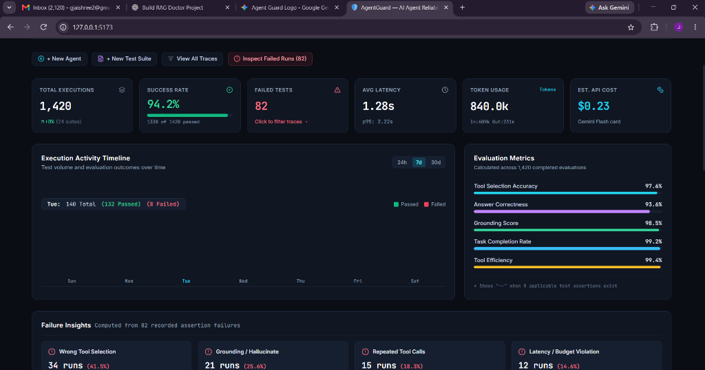
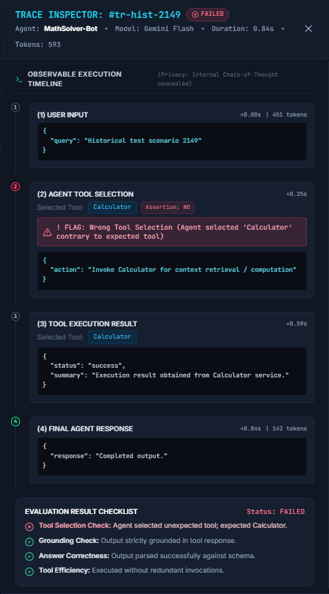

# AgentGuard 🛡️ — AI Agent Reliability, Testing & Evaluation Platform

[](https://fastapi.tiangolo.com)
[](https://react.dev)
[](https://www.typescriptlang.org)
[](https://tailwindcss.com)
[](https://langchain-ai.github.io/langgraph/)
[](https://python.org)
[](https://github.com)

**AgentGuard** is an enterprise-grade AI agent reliability, testing, and evaluation platform inspired by LangSmith's dark cyber-tech aesthetic. It provides automated multi-criteria evaluation, observable execution flight-recording, P95 latency monitoring, and granular failure diagnostics for autonomous LLM agent workflows.

---

## 📸 Platform Overview

### Real-Time Developer Dashboard


### Observable Trace Inspector & Evaluation Checklist


---

## 🚀 Key Architectural Pillars

### 1. Observable Execution Flight Recorder
- Intercepts and records **external observable events**: Tool Call Selection, Dispatch, Tool Output Payloads, Token Usage, and Latency Timings.
- **Strict Privacy Safeguard:** Conceals internal model chain-of-thought to prevent exposure of sensitive reasoning artifacts.

### 2. Multi-Criteria Deterministic Evaluation Engine
Every agent run is automatically evaluated across 5 core reliability criteria:
- **Tool Selection Accuracy:** Verifies sequential tool call ordering against test specifications, detecting unexpected, missing, or out-of-order invocations.
- **Grounding & Hallucination Check:** Audits output claims against tool retrieval payloads to catch ungrounded factual hallucinations.
- **Answer Correctness:** Validates synthesized answers against ground-truth assertion criteria.
- **Tool Call Efficiency:** Detects redundant tool calls and runaway retry loops.
- **SLA & Latency Enforcement:** Monitors wall-clock execution against P95 latency targets.

### 3. Dynamic SQL Analytics Engine
- Built with **FastAPI** and **SQLAlchemy**.
- Implements exact mathematical **nearest-rank P95 latency** calculation.
- Computes real-time failure taxonomy distributions (`WrongToolSelection`, `GroundingHallucination`, `RepeatedToolCalls`, `LatencyViolation`).
- Supports calendar-aligned time-window filtering (`24h`, `7d`, `30d`) and execution mode isolation (`LIVE`, `MOCK`, `SEED`).

### 4. LangSmith-Inspired Cyber-Tech Dashboard
- High-contrast developer interface (`#0a0d14` canvas, `#101622` surface, `#06b6d4` cyan accents).
- Interactive stacked activity charts (Passed vs. Failed volume over time).
- Deep-dive **Trace Inspector Drawer** with step-by-step visual timeline and automated checklists.

---

## 🛠️ Tech Stack

| Domain | Technologies |
|---|---|
| **Backend & API** | Python 3.9+, FastAPI, SQLAlchemy, SQLite (WAL mode), Pydantic v2 |
| **Agent Orchestration** | LangGraph, LangChain, Google Gemini Flash API |
| **Frontend** | React 18, TypeScript, Vite, Tailwind CSS, Lucide Icons |
| **Testing & CI** | Python `unittest`, 18 automated unit and regression tests |

---

## 📂 Project Structure

```text
AgentGuard/
├── backend/
│   ├── app/
│   │   ├── models.py          # SQLAlchemy models (Trace, Step, Evaluation, TestRun)
│   │   ├── database.py        # SQLite session engine with WAL configuration
│   │   ├── config.py          # Pydantic BaseSettings & HMAC secret configuration
│   │   ├── seed_data.py       # Deterministic 1,420-run historical dataset generator
│   │   └── routers/
│   │       ├── analytics.py   # Dynamic SQL metrics, P95 latency, activity time series
│   │       ├── agents.py      # Agent registry & performance metadata
│   │       └── executions.py  # Granular trace detail & observable step synthesis
│   ├── tests/
│   │   ├── test_analytics.py  # 15 unit tests covering nearest-rank P95 & SQL queries
│   │   └── test_executions.py # Regression tests for trace checklist & step rendering
│   └── run.py                 # FastAPI backend server launcher
├── frontend/
│   ├── src/
│   │   ├── components/        # MetricCards, ActivityChart, TraceDrawer, AgentTable
│   │   ├── types/             # TypeScript schemas matching API responses
│   │   └── App.tsx            # Full dashboard view state orchestrator
│   └── vite.config.ts         # Vite build configuration
└── .gitignore
```

---

## ⚡ Quickstart

### 1. Backend Setup
```bash
# Clone the repository
git clone https://github.com/JaishreeGandhi/AgentGuard.git
cd AgentGuard

# Setup Python virtual environment
python -m venv backend_venv
# Windows:
.\backend_venv\Scripts\activate
# Linux/macOS:
source backend_venv/bin/activate

# Install dependencies & run backend
pip install -r backend/requirements.txt
python backend/run.py
```
Backend runs at `http://127.0.0.1:8000` (Swagger docs at `/docs`).

### 2. Frontend Setup
```bash
cd frontend
npm install
npm run dev
```
Frontend runs at `http://127.0.0.1:5173`.

### 3. Run Test Suite
```bash
python -m unittest discover backend/tests
```
*All 18 unit tests pass in < 1 second.*

---

## 📜 License
MIT License. Created by Jaishree Gandhi.

